# Central Park Pigeon

*One pigeon. Seventeen crews. One very large robot.*

You're Gus, a scruffy Central Park pigeon with a scarf and a plan: take over
the park, then the city, and maybe the world. Fly and waddle across a big 3D
Central Park and the blocks of Manhattan around it, win over the park's crews
(squirrels, ducks, crows, rats, cats, geese, owls, horses and more), run five
schemes at once, and build the Mecha-Pigeon out of a hot dog cart, a traffic
cone and a lot of nerve. It's a cosy puzzle caper about plans, not reflexes.

**[▶ Play Central Park Pigeon](https://centralparkpigeon.synapticnoise.com/)** in your browser. No
install, works on desktop and on phones.

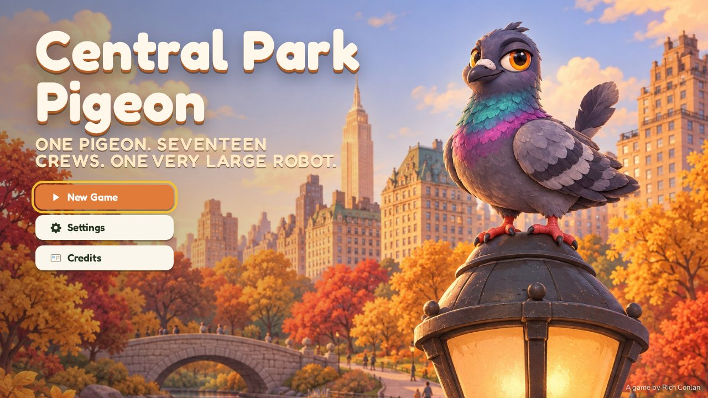

## The park

Seventeen crews, about 700 animals, and every famous corner of the park:
Bethesda Fountain, Bow Bridge, the Ramble, Belvedere Castle, Wollman Rink,
the Reservoir, the Great Lawn and more, with Fifth Avenue and Central Park
West at the edges. You win each crew through its boss and a few named
regulars, and the whole crew joins with them.

| | |
|---|---|
| 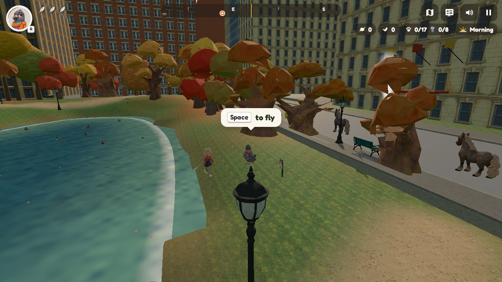 | 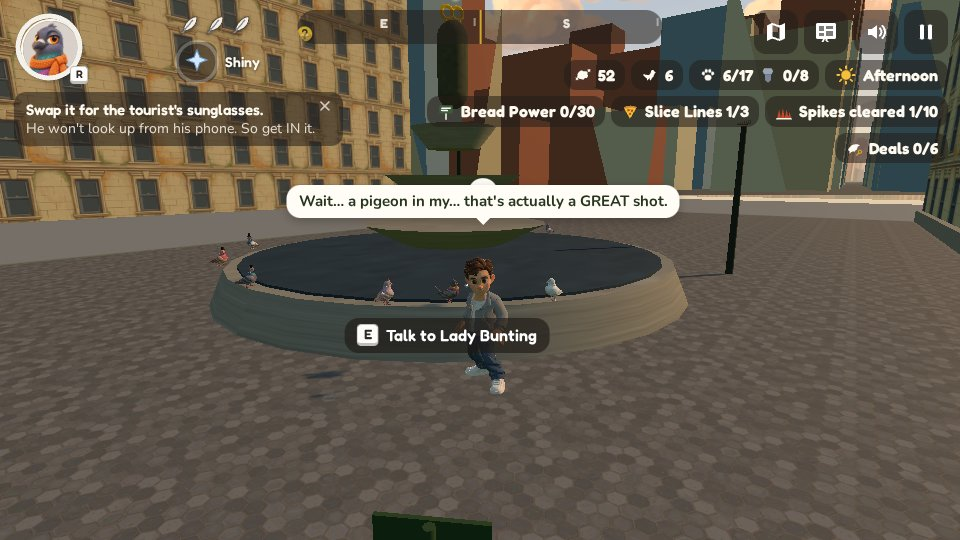 |
| Morning at the Pond. Hop, then take off. | Photobomb a tourist's selfie for her sunglasses. |
| 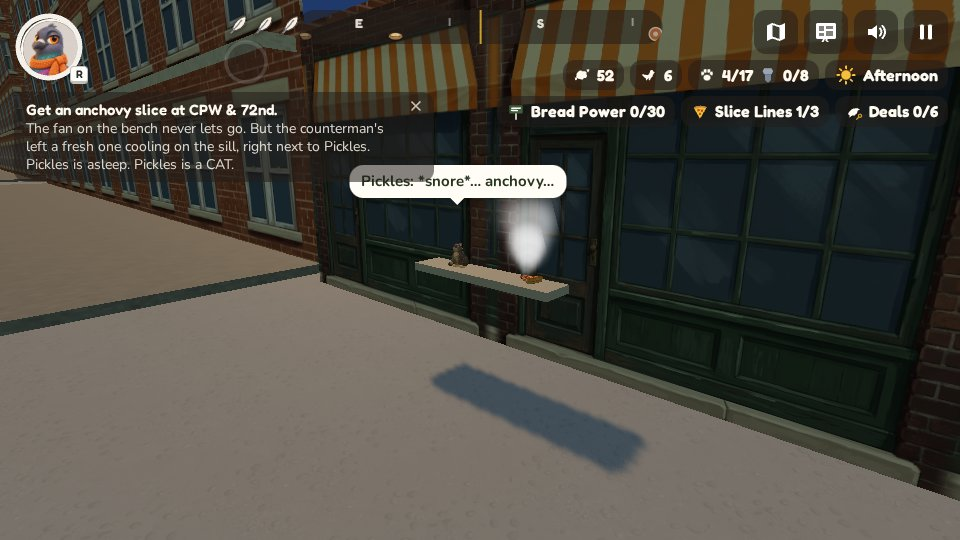 | 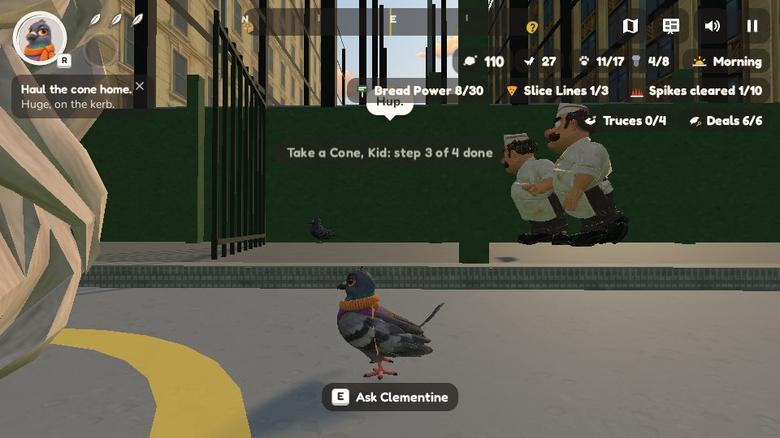 |
| Pickles is asleep. Pickles is a CAT. Wake him at the right moment. | Every friend helps in their own way: Big Ben kicks and hauls. |

## Five schemes at once

The Scheme Board runs five threads side by side: **the Sign War** (turn "Don't
Feed the Birds" into "FEED THE BIRDS" and make it stick), **the Slice Run**
(pizza is currency), **Spikes** (run the Spike Man out of the park), **Feuds &
Truces** (make peace, then make plans) and **the Lost & Found** (the crows'
market for gear a pigeon can't get alone). A win in one opens a shortcut in
another. Along the way you'll launch a stolen Zamboni off a ramp built from
its own snow and book a white pigeon named Dove as a wedding's "dove release".

| | |
|---|---|
| 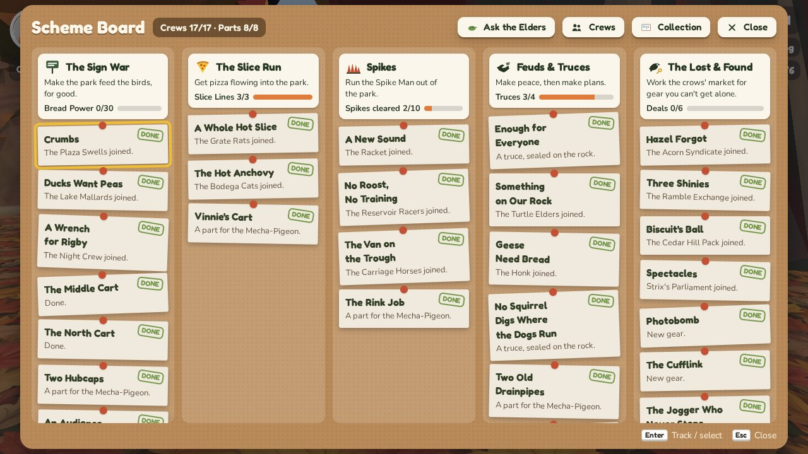 | 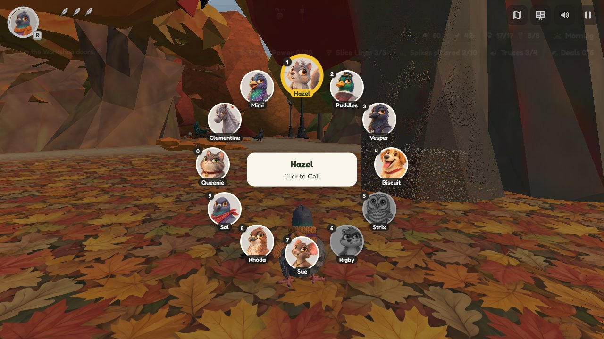 |
| The Scheme Board. Nudges and answers are there if you get stuck. | Call any friend from the ally wheel. They come to you. |
| 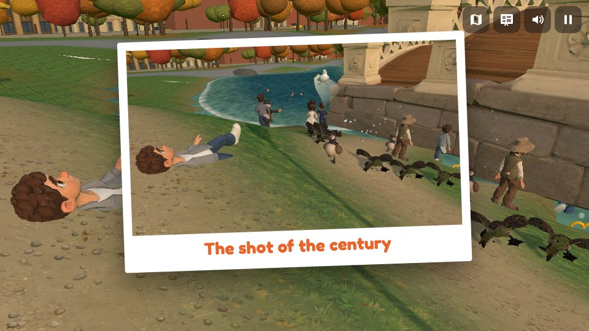 | 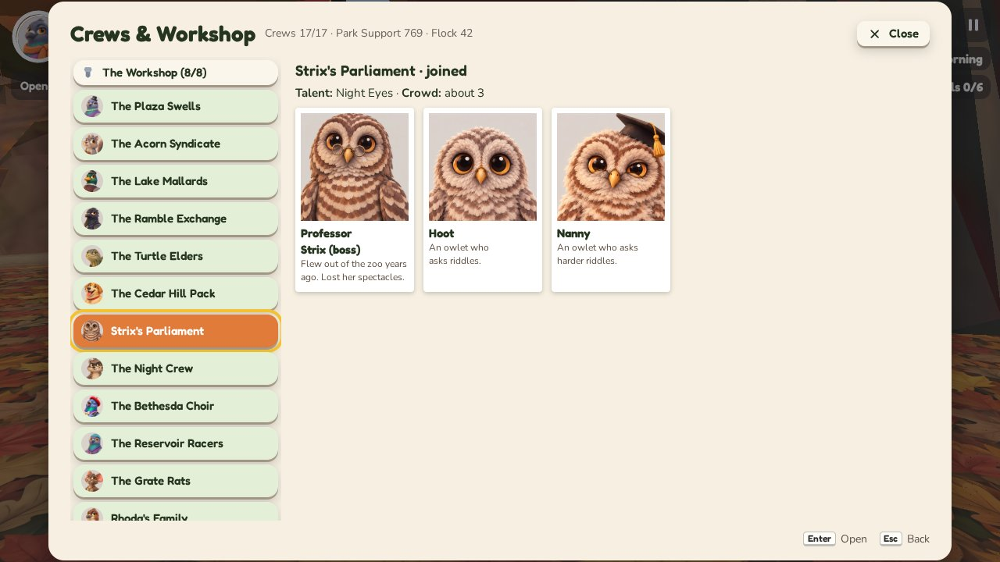 |
| The shot of the century, at the Bow Bridge wedding. | Seventeen crews to win over. |
| 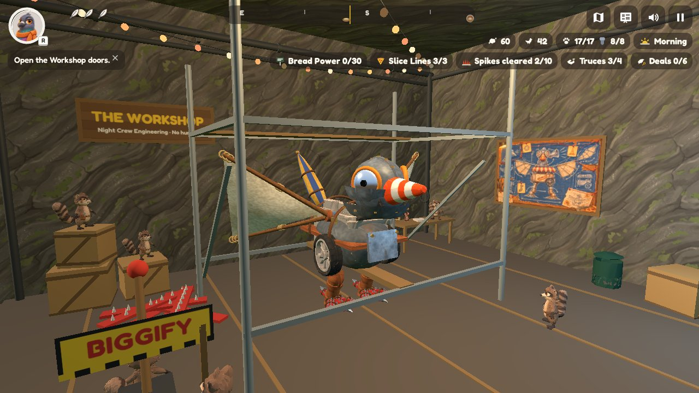 | 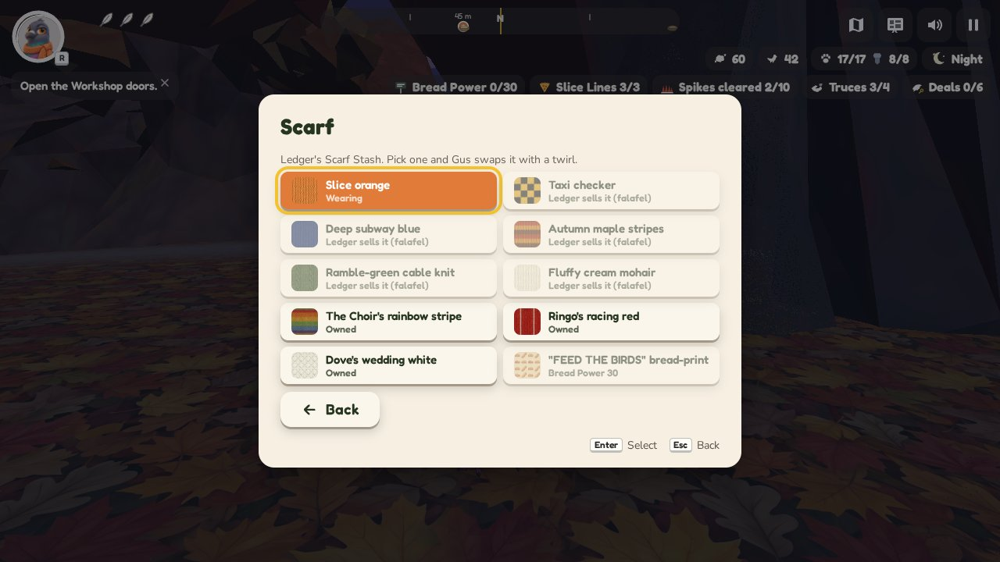 |
| The Workshop: eight parts make the Mecha-Pigeon. | Trade falafel for scarves at Ledger's Scarf Stash. |

## The finale

Eight parts later, the Mecha-Pigeon stomps down Fifth Avenue with every crew
in the park behind it, climbs the Empire State Building, and shouts the only
thing that matters.

| | |
|---|---|
| 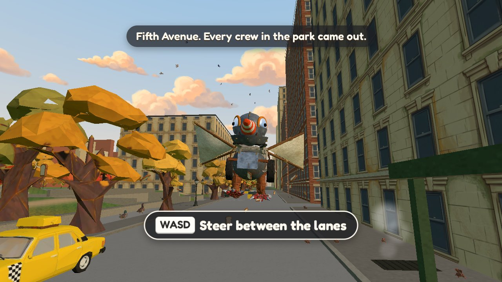 | 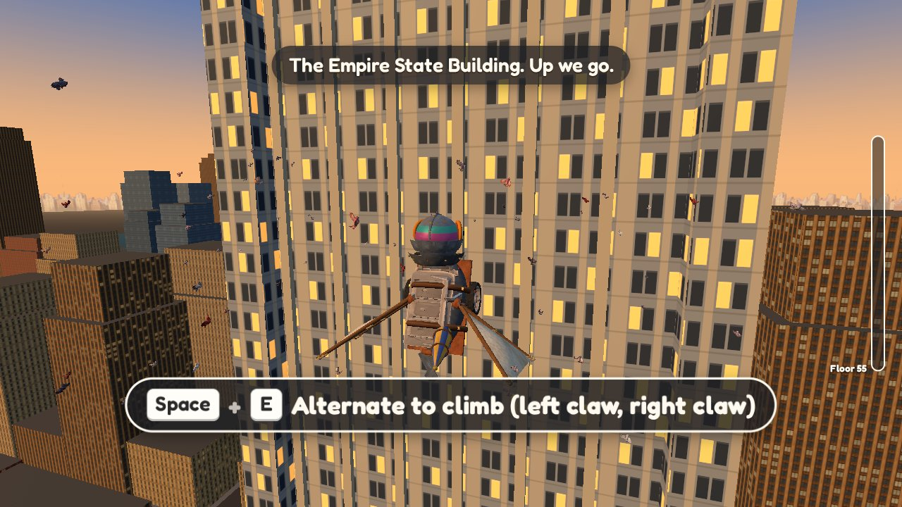 |
| "Fifth Avenue. Every crew in the park came out." | "The Empire State Building. Up we go." |

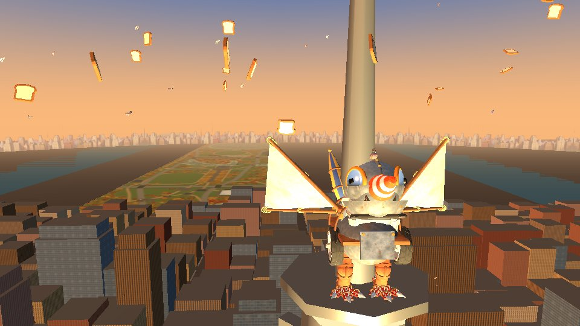

## How to play

On a keyboard and mouse:

- **Move:** WASD or the arrow keys. **Camera:** the mouse.
- **Flap:** Space: a quick tap hops, hold it to take off and climb. **Dive / land:** C.
- **Sprint:** Shift (a boost in the air).
- **Peck:** E (talk, pick up, give, flip a sign, nap on a perch).
- **Coo:** F (tap to gather your flock, hold to swarm). **Drop:** Q.
- **Ally wheel:** hold R, pick a friend, release (or 1 to 0 for quick calls).
- **Scheme Board:** J. **Map:** Tab.
- **Pause:** Esc or P. **Mute:** M. **Photo mode:** V (once you've found the camera).
- **Driving** (yes, you can drive): steer, Space for gas, C to brake, F for
  the horn (or the Zamboni's dump and spray), E to get out.

With a controller (Xbox, PlayStation or Switch Pro; best in Chrome or Edge):

- **Left stick:** move. **Right stick:** camera.
- **A / ✕:** Flap (or hold **RT / R2** to climb). **B / ○:** Dive (or **LT / L2**).
- **X / □:** Peck. **Y / △:** Coo. **LB / L1:** Drop. **RB / R1:** Ally wheel.
- **Click the left stick:** Sprint. **D-pad up:** Scheme Board.
  **View / Create:** Map. **Menu / Options:** Pause. **D-pad right:** Photo mode.
- The on-screen prompts switch to your controller's own buttons.

On a phone, hold it sideways and use the on-screen controls: the stick to
move (push it to the edge to sprint), drag on the right half to look, and the
Flap, Dive, Peck and Coo buttons (double-tap Flap to boost, hold Peck to
drop). Tap Gus's picture for the ally wheel; the Board and Map are the
top-right buttons. The game is made for desktop first, and phones work as a
bonus. You can add it to your home screen from the browser's menu to play
full screen.

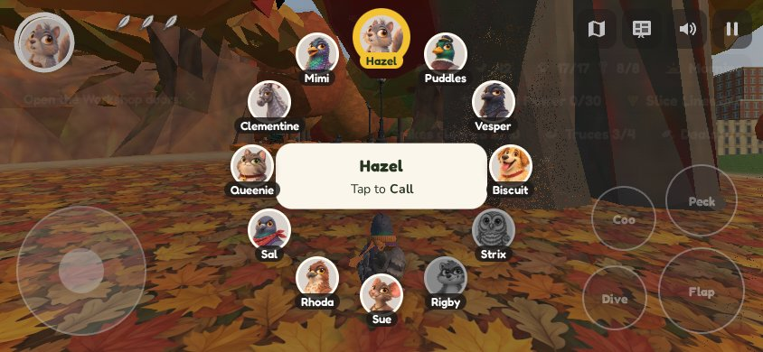

There's no game over. A hawk, a dog or a broom costs a feather; lose all three
and you're Ruffled, waking at your last Nest with nothing lost. Every puzzle
has a gentle nudge and, if you wait a little longer, the answer. The game
saves by itself at every step, nest and nap (and from the pause menu), and
**Continue** picks up where you left off. There are three save slots: **Load**
on the title screen lists them (time of day, crews won over, Mecha parts, time
played), so you can keep more than one park going or share the game with
someone else in your house. After the finale the park is yours to
roam, with postcards, Summit Perches and golden pretzels to collect.

**Super Jumbo Bagels.** On 110th Street, across from the North Woods gate,
Manny's walk-up bagel shop is open 24 hours. Mama Mask has a riddle for an
order ("The Jumbo Order", with a postcard and an Everything Bagel scarf for
getting it right), and a plain bagel dropped near wary animals loosens their
beaks: they'll tell you where their boss is and what the boss wants.

**Photo mode.** Early on, a tourist on Central Park West leaves his old camera
on the balcony rail, and Flicker the crow knows where to get film. Once you
have it (V, D-pad right, or the camera button), the park freezes: orbit and
zoom around Gus, strike a pose, pick a look (Film, Black & White, a postcard
frame), call your crew into the shot, and snap. Photos go to an album in your
browser, where you can download or share them.

Found a bug? **Report a bug** in the pause menu (or Ctrl+Shift+L) sends it
with a screenshot. With a controller, pick what happened from a short list
(a controller can't type); the last step on GitHub needs a mouse or touch.

## How it was made

Central Park Pigeon was made by [Claude Code](https://claude.com/claude-code) with
[gamegen](https://github.com/zeveck/gamegen), from this request:

> --budget $50 --3d --feedback The game is Central Park Pigeon. The idea is that you're a piegon flying around Central Park, exploring, eating food, etc. You decide it's time to take over the park, the city, and maybe the world. The goal of the game is to befriend other animals in the park -- other birds, racoons, squirrels, whatever -- and get them to help you. They each help in different creative ways -- crows can help you trade items with humans to get gear you can't normally get, racoons can rig human vehicles so you can drive them, squirrels and find things underground, ducks can get you things from under the water, etc. You can recruit pigeions and have them flock with you. You can walk around and fly around. Ultimately the game is a big puzzle, though you may fight owls, hawks, angry humans, dogs, etc., at times. Mostly puzzly. You can do things like change the "Don't Feed the Birds" signs to say "Feed the Birds" and then humans near those signs might feed you, but park personel will eventually change the signs back UNLESS you have racoons sabatoge their cars, etc. The park has multiple "gangs" of pigeions and you're also trying to get them all on  your side. Ultimately, you want to recruit all the denizens of the park to your cause, and you're gathering parts to build the Mecha-Pigion, a giant pigeon that can rule over the park. The game's ending includes the Pigion climbing to the top of the Empire State Building and shouting "FEED THE BIRDS". The game itself is mostly a fun exploring the park game, and we want a large and fairly accurae Central Park map, with iconics locations and the like, and maybe a block of NYC around it in any direction so you can potentially fly up a building and perch and maybe there are items and friends to be found out there as well. --gamepad --plan-only --share-design

The design was shared as a page with a card for every character, and the
requests and answers that followed shaped it:

> "The thirteen denizens" is a very small number. I'd expected a much  more sweeping feel, though, it may be, there are just a few named individuals per specifes. Like a bunch of crows/squirrels/ducks/etc., but you only interact with a subset directly.

> Rats and turtles are great! We should probably at least also include cats, horses, and other specifies of birds.

> Think about Central Park and NYC.

> Oh, another puzzle I thought of was being able to nab and carry slices of pizza from place to place. May be to bribe racoons or even people to get them to open a gate or something.

> I see you have the sign war, which is great, but that was meant to be an example. We'd like a few different overlapping puzzles that you're kinda solving in parallel as you explore and befriend.

> I don't want to explode this beyond what's achievable, I just expected a bit more oomph than what this shared explanation covers.

Then, about the design as it took shape:

> I don't want "bloat' but it'd probably be okay to make it a bit bigger than it sounds, but I may be missing a lot that's already here. It needs to stay fun and not toooo complicated. A casual player should enjoy exploring and making friends and solving things and be able to beat it. We're not trying to be hard like Myst or something.

About a first idea for keeping each scheme simple ("one-line goal, one or two clear actions, carry the slice to whoever wants it"):

> this might be leaning TOO simple

> Casual, but not all just obvious fetch quests and nudges. We'd like some clever bits. The FUN is what matters.

About the character cards on the shared page:

> I LOVE these cards/descriptions. [the shared page's character cards] when we're ready the next artifcact should make such a card for each denizen you interact with. If the limit was budget we can add more.

Then the decisions along the way (the budget went from $50 to $100, desktop
came first, and the Zamboni came back as the Rink Job, a puzzle chain that
spans two threads):

Asked whether to make it desktop-first with phones as a bonus, or keep full phone support:

> Yes.

> Bring back the Zamboni. Even better if it's involved in some puzzle chain. I'll change the budget to $100. The goal isn't to spend it all, but to keep from compromising.

After topping up the Meshy credits:

> Now we have 3402.

Asked whether to mark Gus in his flock with a rim light or a scarf:

> I like him having a scarf.

Looking at the mock-up pictures (so the squirrels got four colours and the ducks five more species):

> The squirrels and ducks need a little more variety, but these are just mocks, so maybe that's known?

And so Ledger's Scarf Stash was born (ten scarves, falafel from the halal cart, a wardrobe at the Nests):

> Ledger should probably compliment your scarf, or even let you trade. Or maybe he'll trade falafel for new scarves and you can select which one you're wearing and have a scarf stash?

Then the build itself started with:

> --continue --publish --no-confirm

and, while the art was being made:

> Can you make an artifact page with all the art while we wait?

(which made an art gallery page)

Asked about adding 12 more rigged park people (Dolores, a chess player, a jogger, a tourist, a child, a teen skater, a birder, a businessperson, the halal cart man, the pizza counterman, a dog walker and a carriage driver), about $3 over the $100 budget:

> Yes, we should add all of those. It'll help the variety. Really we should have more than that, but that's a better floor so I can play the game and decide if we need more.

And during the play-testing, when the budget was raised again so every fix
could be made:

> I'd rather raise the budget than not have stuff the play-tester finds get fixed.

After it was online, three save slots were added with:

> --saves --publish --no-confirm

Then, after playing it and filing issues on GitHub, the owner had gamegen fix
them in batches, starting with:

> --fix #8 #23 #19 #16

Asked whether to make an anchovy texture for the slice (about $0.20) or have
Queenie ask for pepperoni:

> yes

And on the open questions from the issue triage:

> Landing seems abrupt. Probably coming down a little too fast?

> Let's use your recommendation.

> You can just land it and I'll try it deployed and we'll adjust if needed.

> Sure, try coded on the dogs so I can see. Though the bigger problem is them passing into hills, buildings, etc.

> Adding a question where you get the camera is good, but it should be on the board/available from the beginning and not too hard? Maybe it's just on a balcony of a building outside the park as a way to get  you out there for a minute? And you need to get film from a crow maybe? Just ideas.

> next batch

That brought hop flight, gentler landings, flight controls on screen, the
open-sky warp, accessories that sit right, people and animals that stay out
of the lake and the hills, bridges you can cross, real fences, trotting dogs,
pigeons that fly in to join the flock, puzzles that can't be lost for good,
and photo mode.

gamegen planned the game in a design document, had review agents vet it over
three rounds (86 findings, every must-fix fixed), and shared the design as a
page. It then made the art, models, music and sound with these plugins, built
the game in three.js, and play-tested it: an autopilot recorded a solution for
every scheme and the finale and replayed all 40 after every change, then
played the whole game from New Game to the credits. A bug hunter and a
play-tester reviewed it twice each, a "fun pass" made the puzzles cleverer,
and a polish pass tidied every screen.

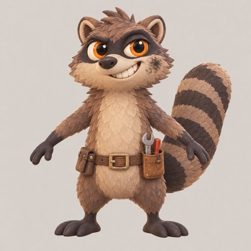

- [imagegen2](https://github.com/zeveck/imagegen2): the key art, 15 mock-up
  pictures and about 90 character cards (every named animal, from Rigby the
  raccoon mechanic to Strix the owl), which became the 72 portraits in the
  game; 70 concept pictures for the 3D models, including the Mecha-Pigeon's
  look; the ground, facade and Empire State Building textures, ten knitted
  scarf patterns, the skies and skyline, the post-credits picture, the app
  icon, Gus's portrait in each scarf, the Workshop blueprints and the nap
  picture.

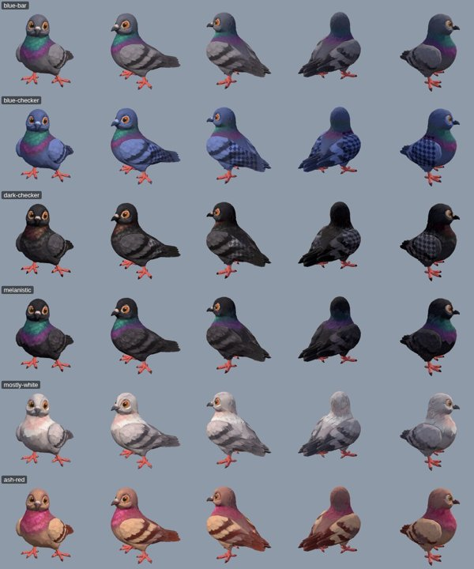

- [nanogen](https://github.com/zeveck/nanogen): 26 edits of the 3D models'
  own textures that turned one pigeon model into thirteen real pigeon colours
  (blue bar, checker, ash-red, pied, grizzle, mealy, pure white for Dove and
  more) and one squirrel into grey, cinnamon, black and nearly white.

 

- [meshgen](https://github.com/zeveck/meshgen): 100 textured 3D models made
  with [Meshy](https://www.meshy.ai/): Gus standing and flying, the park's
  animals (pigeons, squirrels, ducks of several kinds, geese, crows, raccoons,
  rats, cats, dogs, horses, owls, hawks, turtles, herons, songbirds), 18
  rigged and animated people, the vehicles (taxi, van, pedicab, carriage,
  Zamboni, ice-cream truck, rowboat), props and landmarks like Bethesda
  Fountain, Bow Bridge and Belvedere Castle. The Mecha-Pigeon and the Empire
  State Building were built in code from those models.

  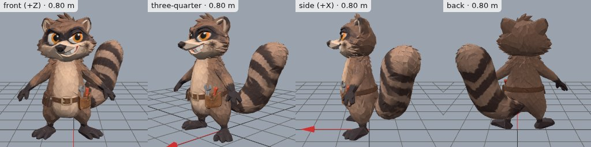

- [audiogen](https://github.com/zeveck/audiogen): all the sound, made with
  [ElevenLabs](https://elevenlabs.io/): 19 pieces of music (a different mood
  for each time of day, the finale and the sting), 10 ambience loops, about
  120 sound effects and 63 voice lines, from the coos to the photographer's
  "THAT'S the shot".

The whole game cost about **$102.91** to make: about $15.61 of imagegen2
pictures, $3.48 of nanogen edits, $24.60 of ElevenLabs audio and $59.22 of
Meshy models (2,961 prepaid credits). The full ledger is in
[design/ASSETS.md](design/ASSETS.md), and the design is in
[design/GAME_DESIGN.md](design/GAME_DESIGN.md).

## Playing locally

Central Park Pigeon is a plain web page with no build step. Serve the `game`
folder with any static web server, for example:

    cd game
    python3 -m http.server 8000

then open http://localhost:8000. (Browsers won't run it from a double-clicked
file.) The first load fetches the park's models and sounds, so give it a
minute.

## Credits

A game by **Rich Conlan**.

- Fonts: Fredoka and Nunito, SIL Open Font License 1.1 (game/fonts/OFL-Fredoka.txt, game/fonts/OFL-Nunito.txt).
- [three.js](https://threejs.org/), MIT License (game/vendor/LICENSE).
- [gh-feedback](https://github.com/zeveck/gh-feedback) for bug reports, MIT
  License (game/vendor/gh-feedback-SOURCE.txt).
- Real places and kinds of park life; every character is original.
